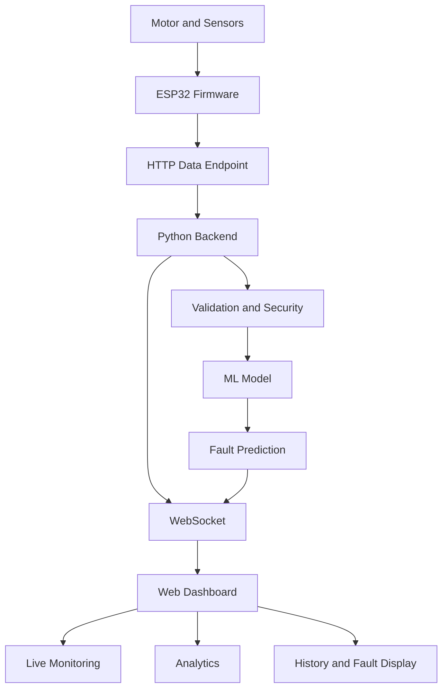

# MotorGuardX
### AI-Powered Motor Monitoring, Fault Detection & Intelligent Fan Control

MotorGuardX is an IoT-based motor condition-monitoring and fault-detection prototype combining sensor acquisition, machine-learning classification, real-time visualization, secure backend communication, and cooling-fan monitoring/control.

An ESP32 collects motor-related sensor readings and sends them to a Python backend. The backend validates incoming requests, processes sensor data, runs the trained machine-learning model (where configured), and publishes updates to the dashboard.

> **Project status:** Prototype / academic project. Hardware, sensor calibration, model performance, storage, and deployment behaviour depend on the actual configuration.

---

## Table of Contents

- [Features](#features)
- [Architecture](#architecture)
- [Fault Categories](#fault-categories)
- [Monitored Data](#monitored-data)
- [Hardware](#hardware)
- [Technology Stack](#technology-stack)
- [Repository Structure](#repository-structure)
- [Run Locally](#run-locally)
- [Configure the ESP32](#configure-the-esp32)
- [Backend Endpoints](#backend-endpoints)
- [Deploy to Render](#deploy-to-render)
- [Security](#security)
- [Testing](#testing)
- [Troubleshooting](#troubleshooting)
- [Limitations and Safety](#limitations-and-safety)
- [Future Work](#future-work)
- [Repository](#repository)

---

## Features

- **Live motor monitoring:** View reported motor and sensor measurements.
- **ML-based classification:** Use the bundled model and backend prediction pipeline to classify operating conditions.
- **Fault-condition monitoring:** Surface model-detected conditions on the dashboard.
- **ESP32 integration:** Collect sensor measurements and transmit them to the backend.
- **Cooling-fan integration:** Monitor fan-related status and use configured fan-control logic.
- **Live dashboard:** Receive updates through WebSocket communication.
- **Analytics:** Visualize sensor trends and monitoring data supported by the application.
- **History:** Review historical records supported by the application.
- **Authentication:** Protected dashboard access through the configured authentication system.
- **Request security:** API-key/HMAC validation and sensor-data validation, as configured.

---

## Architecture



### Data flow

1. Sensors measure motor-related parameters.
2. The ESP32 reads and formats the sensor values.
3. The ESP32 sends a request to the backend data endpoint.
4. Backend security and validation checks are applied.
5. Valid data is processed by the backend and the ML pipeline, as configured.
6. The backend distributes updates through WebSocket communication.
7. The dashboard renders the current values and prediction/status information.

---

## Fault Categories

The project dataset/model workflow includes the following category names. The actual categories emitted at runtime depend on the trained model and backend mapping.

| Category | Intended interpretation |
|---|---|
| `NORMAL` | Operating condition classified as normal |
| `OVERCURRENT` | Operating condition associated with excessive current |
| `OVERHEAT` | Operating condition associated with elevated temperature |
| `UNBALANCE` | Operating condition associated with abnormal vibration/imbalance |
| `STOPPED` | Motor classified as stopped |

> Model labels are predictions, not certified diagnoses. Confirm the model's class mapping and inference implementation before using these labels for decisions.

---

## Monitored Data

The firmware/backend workflow is designed around sensor readings such as:

| Parameter | Purpose |
|---|---|
| Temperature | Monitor thermal behaviour |
| Current | Monitor electrical current |
| RPM | Monitor rotational speed |
| Vibration | Monitor vibration behaviour |
| Fan status | Report configured fan status |
| Motor/status fields | Report operating status, where implemented |

The exact payload format and field names must match the ESP32 firmware and backend implementation.

---

## Hardware

Hardware used or contemplated in the prototype includes:

| Component | Role |
|---|---|
| ESP32 development board | Sensor acquisition and network communication |
| Temperature sensor | Temperature measurement |
| Current sensor | Current measurement |
| RPM sensor | Speed measurement |
| Vibration sensor | Vibration measurement |
| Motor | Monitored machine |
| Cooling fan | Cooling/control demonstration |
| Power supply and wiring | Power and electrical connections |

The specific sensor models, wiring, pin assignments, ranges, and calibration are installation-dependent. Refer to the firmware and wiring documentation for the exact build.

---

## Technology Stack

| Technology | Role |
|---|---|
| Python | Backend application and ML integration |
| aiohttp | Asynchronous HTTP/WebSocket server |
| ESP32 | Embedded sensor collection and communication |
| Arduino IDE | Firmware development and upload |
| Machine learning | Classification of operating conditions |
| HTML | Dashboard pages |
| CSS | Dashboard styling |
| JavaScript | Dashboard logic and WebSocket client |
| WebSocket | Live backend-to-dashboard updates |
| GitHub | Source-code hosting and version control |
| Render | Example cloud hosting platform |

---

## Repository Structure

```text
MotorGuardX/
├── server.py                 # Backend server
├── auth.py                   # Authentication routes and logic
├── security.py               # Request security and validation
├── model.py                  # Model-related processing
├── thermal_controller.py      # Thermal-control logic (if implemented)
├── modelDecision.pkl          # Serialized trained model
├── dataset.csv               # Dataset
├── generate_datasets.py       # Dataset-generation utility
├── esp32.c                   # ESP32 firmware source (project copy)
├── secrets.h                  # Firmware secrets/configuration; do not commit secrets
├── analytics.html             # Analytics interface
├── history.html               # History interface
├── live.html                  # Live monitoring interface
├── web.html                   # Dashboard/interface page
├── script.js                  # Frontend logic
├── style.css                  # Frontend styling
├── static/                    # Static assets
├── requirements.txt            # Python dependencies
├── test_endpoint.py            # Endpoint tests
├── test_security.py            # Security tests
└── README.md
```

Files and names may differ as the repository evolves. Keep this tree synchronized with the actual repository contents.

---

## Run Locally

### Prerequisites

- Python 3
- Git
- Arduino IDE (for firmware)
- ESP32 board and sensors (for hardware testing)

### 1. Clone the repository

```bash
git clone https://github.com/itzmedarsh/MotorGuardX.git
cd MotorGuardX
```

### 2. Create a virtual environment

macOS/Linux:

```bash
python3 -m venv venv
source venv/bin/activate
```

Windows PowerShell:

```powershell
py -m venv venv
.\venv\Scripts\Activate.ps1
```

### 3. Install dependencies

```bash
python -m pip install --upgrade pip
pip install -r requirements.txt
```

### 4. Configure environment variables

Set the environment variables required by the backend. Use the names expected by your current code.

Example configuration (values are placeholders):

```dotenv
PORT=5001
SESSION_SECRET=replace_with_a_secure_value
MOTORGUARD_API_KEY=replace_with_api_key
MOTORGUARD_HMAC_SECRET=replace_with_hmac_secret
COOKIE_SECURE=false
```

For local testing over HTTP, the cookie setting may need to be configured for local use as supported by your application. For production HTTPS, configure secure cookies appropriately.

**Do not commit real secrets or credentials.** Use a local `.env` file only if the application loads it, and ensure `.env` is excluded by `.gitignore`. Environment-variable names above are examples of the configuration previously used in this project; confirm them against the current code.

### 5. Run the backend

```bash
python server.py
```

If configured for port `5001`, open:

- Dashboard: `http://localhost:5001/`
- Login: `http://localhost:5001/login`
- Health: `http://localhost:5001/health`

The actual port depends on the server configuration/environment.

---

## Configure the ESP32

Firmware is developed and uploaded using the Arduino IDE.

1. Install Arduino IDE.
2. Install ESP32 board support in the Boards Manager.
3. Open the firmware project/source.
4. Configure the board and serial port.
5. Set Wi-Fi and backend credentials using a local secrets/configuration file.
6. Configure the backend URL to point to the server.
7. Upload the firmware.
8. Open Serial Monitor at the firmware's configured baud rate.
9. Confirm sensor readings and request/response status.

### Cloud endpoint

For a deployed backend, configure the firmware to send data to the cloud data endpoint, for example:

```text
https://YOUR-SERVICE-NAME.onrender.com/data
```

Replace the example URL with your actual service URL. The request method, payload, API key, signature, timestamp, nonce, and other headers must match the backend's requirements.

### Local network testing

The ESP32 cannot use `localhost` to reach a server running on your computer. For local-network testing, use the computer's LAN IP address and ensure the computer and ESP32 can reach each other on the network.

---

## Backend Endpoints

The project server is intended to provide routes such as the following (verify against the current `server.py`):

| Endpoint | Method | Purpose |
|---|---|---|
| `/` | GET | Dashboard |
| `/login` | GET/POST | Login flow |
| `/health` | GET | Health/status check |
| `/data` | POST | Sensor-data ingestion |
| `/ws` | GET | WebSocket connection |

Access control and response behaviour are determined by the deployed backend and its middleware.

### Health check

```text
http://localhost:5001/health
```

Use the deployed service URL instead of localhost when checking the cloud service.

---

## Deploy to Render

MotorGuardX can be deployed as a Render Web Service, provided its dependencies, configuration, and persistence requirements are set up for the platform.

### Deployment steps

1. Push the project to GitHub.
2. Sign in to Render.
3. Create a new **Web Service**.
4. Connect the `MotorGuardX` repository.
5. Select the branch to deploy (commonly `main`).
6. Configure the build and start commands.
7. Add environment variables in the Render service settings.
8. Deploy.
9. Review the deployment logs.
10. Test `/health`, login, dashboard, and ESP32 data ingestion.

### Example build/start configuration

| Setting | Value |
|---|---|
| Runtime | Python |
| Build command | `pip install -r requirements.txt` |
| Start command | `python server.py` |

The server must bind to `0.0.0.0` and use the port supplied by the hosting environment (commonly through `PORT`). Confirm that your current server code does both.

### Environment variables

Configure the environment variables required by your code in Render's environment settings. Example names:

| Variable | Purpose |
|---|---|
| `PORT` | Port provided by the platform |
| `SESSION_SECRET` | Session protection/configuration |
| `MOTORGUARD_API_KEY` | API authentication |
| `MOTORGUARD_HMAC_SECRET` | Request-signature validation |
| `COOKIE_SECURE` | Secure-cookie configuration |

Use unique production secrets. Never put secret values in this README, firmware committed to GitHub, screenshots, or logs.

### After deployment

- Open the deployed `/health` endpoint.
- Load the dashboard and authentication page.
- Check Render logs while the ESP32 sends data.
- Check the ESP32 Serial Monitor for response codes.
- Verify WebSocket updates and model predictions.

Cloud persistence (such as user accounts, history, and logs) must be configured according to the hosting platform's filesystem/database requirements. Do not assume ephemeral service storage is permanent.

---

## Security

Security mechanisms in the project may include:

- User authentication.
- Session handling.
- API-key checks.
- HMAC request signing/validation.
- Sensor-data validation.
- Middleware-based access control.
- HTTPS for cloud traffic.

### Security practices

- Do not commit `.env`, `secrets.h` containing real credentials, private keys, API keys, HMAC secrets, session secrets, or passwords.
- Use `.gitignore` to exclude sensitive files.
- Rotate any secret that has been exposed publicly.
- Use HTTPS in cloud deployments.
- Keep dependencies updated.
- Avoid logging secrets or sensitive personal data.
- Validate data received from devices.
- Review authentication and API access rules before deployment.

---

## Testing

Install dependencies and activate the virtual environment before running tests.

### Security tests

```bash
python test_security.py
```

### Endpoint tests

```bash
python test_endpoint.py
```

These are repository test scripts; test coverage and test behaviour depend on their current implementation. Review test output and ensure any test configuration is appropriate before running against a live service.

---

## Troubleshooting

### Backend fails to start

- Check Python version and dependency installation.
- Confirm the start command and working directory.
- Review server logs.
- Verify required environment variables.

### ESP32 cannot reach the backend

- Check Wi-Fi connectivity.
- Confirm the backend URL.
- Use the computer's LAN IP for local-network testing, not `localhost` from the ESP32.
- Check cloud deployment status and logs.
- Verify API key/signature configuration.

### HTTP 401

Possible causes include an incorrect API key, HMAC secret, request signature, timestamp, nonce, or other authentication requirements. Check backend and firmware configuration without exposing secrets.

### HTTP 302 redirect

A redirect may indicate that the request is being redirected by authentication middleware or route configuration. Inspect the redirect destination and backend logs. Device API requests should follow the API-authentication flow expected by the server, rather than a browser login flow.

### Dashboard not updating

- Check the browser console for JavaScript errors.
- Confirm the WebSocket endpoint is reachable.
- Check whether the backend is receiving sensor requests.
- Confirm the frontend and backend agree on field names and message structure.

### ML category not visible

- Confirm the model file exists and loads.
- Check model inference in backend logs.
- Verify that enough/valid sensor readings are received if the model pipeline uses calibration or warm-up.
- Inspect the WebSocket payload for prediction fields.
- Check frontend rendering and class-name mapping.

---

## Limitations and Safety

MotorGuardX is a prototype/academic monitoring project. Sensor accuracy depends on hardware, installation, calibration, and electrical noise. ML output depends on the dataset, model, training process, input features, and implementation.

**Do not use this prototype as the sole protection for machinery or personnel.** Use appropriately rated hardware protection, emergency stops, overload protection, thermal protection, and qualified electrical design for real installations.

---

## Future Work

Potential improvements include:

- Additional motor fault classes and datasets.
- Model evaluation and calibration.
- Fault alerting and notifications.
- More robust long-term data storage.
- Expanded analytics and reporting.
- Improved mobile responsiveness.
- Edge inference.
- Sensor calibration workflows.
- Additional industrial communication options.

---

## Repository

GitHub: https://github.com/itzmedarsh/MotorGuardX

---

**MotorGuardX — Intelligent Motor Monitoring Through IoT and Machine Learning.**
